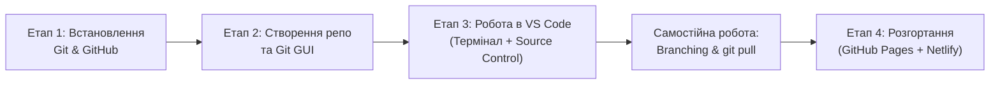
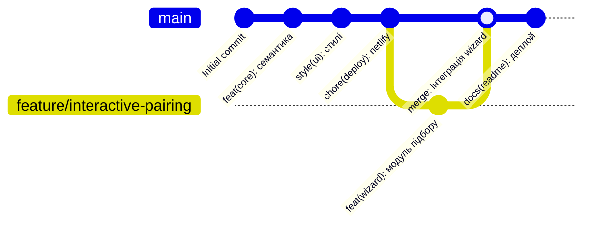

# МІНІСТЕРСТВО ОСВІТИ І НАУКИ УКРАЇНИ
## Національний університет «Львівська політехніка»
### Інститут комп'ютерних наук та інформаційних технологій (ІКНІ)
### Кафедра систем автоматизованого проектування (САПР)

---

# ЗВІТ
### до лабораторної роботи з дисципліни «Технології веб-розробки та дизайну»
**на тему:**  
### «Робота з локальними та віддаленими репозиторіями через VS Code, система контролю версій Git, культура комітів та розгортання вебсторінки в мережі Інтернет (GitHub Pages, Netlify)»

---

### Відомості про проєкт та автора:

| Параметр | Значення |
| :--- | :--- |
| **Освітній / бізнес-вебпроєкт** | **SOMELIA** — інтерактивна гастрономічна платформа українських крафтових сирів та вин |
| **Тематичний напрям** | Електронна комерція, локальний агротуризм та інтелектуальний Food Pairing |
| **Публічний репозиторій GitHub** | [github.com/rusincuk/somelia](https://github.com/rusincuk/somelia) |
| **Історія комітів на GitHub** | [github.com/rusincuk/somelia/commits](https://github.com/rusincuk/somelia/commits?author=rusincuk) |
| **Розгорнутий сайт (GitHub Pages)** | [rusincuk.github.io/somelia](https://rusincuk.github.io/somelia/) |
| **Розгорнутий сайт (Netlify)** | [somelia-craft.netlify.app](https://somelia-craft.netlify.app) |
| **Виконала** | студентка групи **ПП-25** **Русинчук Юлія** |
| **Перевірила** | доцент кафедри САПР **Паращин Ж.Д.** |
| **Місто та рік** | **Львів — 2026** |

---

## 1. Мета роботи та стек інструментів

> [!NOTE]
> **Мета роботи:** Опанувати практичні навички роботи з розподіленою системою контролю версій **Git** локально та через хмарну платформу **GitHub**.  
> Дослідити повний життєвий цикл версіонування вебпроєкту у середовищі **Visual Studio Code**: від ініціалізації та індексації (Staging) до фіксації (Commit), розгалуження (Branching), злиття (Merging) та синхронізації (Push/Pull).  
> Засвоїти культуру ведення історії проєкту за міжнародним стандартом **Conventional Commits**.  
> Набути практичного досвіду розгортання (deployment) статичного мультисторінкового сайту SOMELIA за двома альтернативними технологіями: через **GitHub Pages** безпосередньо з гілки репозиторію та через сучасний PaaS-хостинг **Netlify** з безперервною інтеграцією (CI/CD) і налаштуванням захисних HTTP-заголовків.

### Стек інструментів та програмне забезпечення

| Інструмент / Технологія | Версія / Призначення | Роль у виконанні роботи |
| :--- | :--- | :--- |
| **Visual Studio Code** | v1.95+ | Основне інтегроване середовище розробки (IDE), робота з терміналом та GUI Source Control |
| **Git CLI** | v2.47+ (Windows) | Консольний рушій контролю версій: команди індексації, комітів, розгалуження та злиття |
| **GitHub** | Хмарна платформа | Хостинг публічного віддаленого репозиторію (`rusincuk/somelia`), візуалізація комітів і PR |
| **GitHub Pages** | Static Hosting | Хостинг статичного сайту з гілки `main`, розгортання без додаткового сервера |
| **Netlify** | PaaS Cloud Hosting | Високошвидкісний деплой, підтримка `netlify.toml` (безпекові заголовки) та `_redirects` |
| **Стек проєкту SOMELIA** | HTML5, Tailwind CSS, JS | Мультисторінковий гастрономічний каталог, майстер підбору пар, адаптивний медіа-хаб |
| **Оболонка PowerShell** | v7+ (Windows) | Виконання автоматизованих скриптів тестування та команд Git |
| **ШІ-асистенти** | Claude, Gemini, ChatGPT | Допомога у формуванні `.gitignore`, семантики комітів та конфігурації хостингів |

---

## 2. Посилання на публічні ресурси проєкту

| Ресурс | Пряме гіперпосилання | Опис та статус артефакту |
| :--- | :--- | :--- |
| **GitHub Репозиторій** | [github.com/rusincuk/somelia](https://github.com/rusincuk/somelia) | Публічний репозиторій з кодом сайту SOMELIA, налаштованим `.gitignore` та документацією |
| **Історія комітів** | [github.com/rusincuk/somelia/commits](https://github.com/rusincuk/somelia/commits?author=rusincuk) | Хронологічний перелік фіксацій авторки за специфікацією Conventional Commits |
| **GitHub Pages** | [rusincuk.github.io/somelia](https://rusincuk.github.io/somelia/) | Опублікований статичний сайт SOMELIA (джерело: гілка `main`, каталог `/`) |
| **Netlify Деплой** | [somelia-craft.netlify.app](https://somelia-craft.netlify.app) | Production Deploy з SSL-сертифікатом, заголовками безпеки та миттєвим оновленням |

---

## 3. Покроковий хід виконання роботи



### Етап 1. Встановлення та глобальне налаштування Git і GitHub

На початковому етапі було встановлено клієнтську програму Git для Windows та налаштовано обов'язкові параметри ідентифікації розробника, які зашиваються у кожен створений коміт:

```bash
# Встановлення імені автора комітів
git config --global user.name "rusincuk"

# Встановлення офіційної електронної пошти автора
git config --global user.email "rusincukulia@gmail.com"

# Визначення назви головної гілки за замовчуванням
git config --global init.defaultBranch main

# Налаштування автоматичного конвертування кінців рядків для Windows (CRLF -> LF)
git config --global core.autocrlf true
```

### Етап 2. Створення репозиторіїв та робота через Git GUI

1. На платформі GitHub створено віддалений публічний репозиторій `rusincuk/somelia` з первинним файлом `README.md`.
2. Репозиторій було клоновано на робочу машину за адресою `C:\Users\admin\Desktop\Somelia_git\somelia`.
3. Випробувано роботу через вбудований графічний інструмент **Git GUI** (викликається через контекстне меню провідника *Open Git GUI here*):
   - У вікні *Unstaged Changes* переглянуто додані файли;
   - За допомогою кнопки **Stage Changed** зміни перенесено до індексу;
   - Заповнено поле *Commit Message* та зафіксовано версію кнопкою **Commit**;
   - За допомогою команди **Push** зміни було відправлено на сервер GitHub.

### Етап 3. Робота з репозиторіями через Visual Studio Code

Проєкт відкрито у редакторі Visual Studio Code через меню **File → Open Folder**. Редактор автоматично виявив наявність службової папки `.git` та інтегрував засоби версіонування.

#### 1. Робота через термінал VS Code
Вбудований термінал (`Ctrl + ~`) дозволяє швидко виконувати всі низькорівневі інструкції Git:
- `git status` — перевірка поточної гілки та наявності змінених/неіндексованих файлів;
- `git add <file>` або `git add .` — перенесення файлів до Staging Area;
- `git commit -m "..."` — створення коміту;
- `git log --graph --oneline --decorate --all` — наочна візуалізація історії та злиттів;
- `git push origin main` — передача локальних комітів на віддалений сервер.

#### 2. Робота через панель Source Control
Графічна панель Source Control (`Ctrl + Shift + G`) надає зручний інтерфейс для швидкої роботи:
- **Відстеження змін та колірні маркери статусів:**
  - **M (Modified)** — існуючий файл було змінено;
  - **U (Untracked)** — новий файл, який ще не відстежується системою Git;
  - **D (Deleted)** — файл видалено з робочої директорії;
- **Індексація (Staging):** натискання кнопки `+` навпроти окремого файлу або на заголовку *Changes* (*Stage All Changes*);
- **Коміт:** введення повідомлення у верхньому полі та натискання кнопки **Commit** (або комбінація `Ctrl + Enter`);
- **Синхронізація (Sync Changes):** натискання кнопки у рядку стану (Status Bar) для автоматичного виконання push/pull.


*Рисунок 1 — Графічний інтерфейс вкладки Source Control у VS Code: маркування файлів (M, U, D), список Staged Changes, поле опису коміту та індикатор синхронізації*


*Рисунок 2 — Виконання команд git status та git log --graph --oneline у терміналі VS Code (відображення дерева 7 комітів проєкту SOMELIA)*

---

### Етап 4. Розгортання сторінки в Інтернет

#### 1. Публікація через GitHub Pages
1. У браузері відкрито репозиторій [github.com/rusincuk/somelia](https://github.com/rusincuk/somelia) → вкладка **Settings** → розділ **Pages**.
2. У меню **Build and deployment** обрано джерело **Deploy from a branch**.
3. У полі **Branch** вказано гілку `main` та каталог `/ (root)`, після чого натиснуто кнопку **Save**.
4. Після завершення автоматизованого GitHub Action сайт став доступним усьому світу за посиланням:  
   👉 **[https://rusincuk.github.io/somelia/](https://rusincuk.github.io/somelia/)**


*Рисунок 3 — Панель налаштувань GitHub Pages: підтвердження активного статусу релізу з гілки main*

#### 2. Публікація на безкоштовному хостингу Netlify
1. Здійснено вхід на платформу [Netlify.com](https://www.netlify.com/) за допомогою облікового запису GitHub.
2. Обрано команду **Add new site → Import an existing project → GitHub**.
3. Надано авторизований доступ до репозиторію `rusincuk/somelia`.
4. Вказано конфігураційні параметри:
   - **Branch to deploy**: `main`;
   - **Build command**: *залишено порожнім* (проєкт побудований на чистому статичному HTML/Tailwind CDN);
   - **Publish directory**: `.` (кореневий каталог).
5. Створено файл конфігурації `netlify.toml` з політиками безпеки HTTP-заголовків:
   ```toml
   [build]
     publish = "."

   [[headers]]
     for = "/*"
     [headers.values]
       X-Frame-Options = "DENY"
       X-XSS-Protection = "1; mode=block"
       X-Content-Type-Options = "nosniff"
       Referrer-Policy = "strict-origin-when-cross-origin"
   ```
6. Створено файл `_redirects` для запобігання помилкам 404: `/* /index.html 200`.
7. Натиснуто кнопку **Deploy site**, після чого Netlify розгорнув проєкт за постійною адресою:  
   👉 **[https://somelia-craft.netlify.app](https://somelia-craft.netlify.app)**


*Рисунок 4 — Дашборд Netlify: статус релізу Published, налаштування CI/CD та активні правила безпеки*

---

## 4. Виконання завдань для самостійної роботи

### 4.1. Опанування команди синхронізації `git pull`

> [!IMPORTANT]
> **Принцип дії команди `git pull`:**  
> Команда `git pull` є складеною. Вона автоматично об'єднує два послідовні процеси:
> 1. `git fetch origin` — зв'язується з віддаленим сервером і викачує нові коміти та гілки у локальний кеш посилань `origin/main` (при цьому робочі файли розробника не змінюються).
> 2. `git merge FETCH_HEAD` — бере завантажені зміни та зливає їх у поточну активну гілку (`main`).
> 
> Якщо на локальній машині не було створено розбіжних комітів, відбувається злиття типу **Fast-Forward** (просте переміщення покажчика вперед).

У терміналі проєкту SOMELIA виконано перевірку стану та актуалізацію репозиторію:
```bash
PS C:\Users\admin\Desktop\Somelia_git\somelia> git pull origin main
From https://github.com/rusincuk/somelia
 * branch            main       -> FETCH_HEAD
Already up to date.
```

### 4.2. Створення ізольованих гілок (Branching) та безпечне злиття (Merging)

Для розробки нового інтерактивного модуля — **Майстра підбору гастрономічних пар** (`pairing-wizard.html` та `pairing-result.html`) було застосовано класичний інженерний підхід **Feature Branch Workflow**:



1. **Створення та перехід у нову гілку:**
   ```bash
   git checkout -b feature/interactive-pairing
   # Результат: Switched to a new branch 'feature/interactive-pairing'
   ```
2. **Розробка та індексація компонентів wizard-підбору:**
   ```bash
   git add pairing-wizard.html pairing-result.html js/
   git commit -m "feat(wizard): реалізувати інтерактивний майстер підбору сиру та вина"
   ```
3. **Повернення до головної гілки `main`:**
   ```bash
   git checkout main
   ```
4. **Безпечне злиття зі створенням окремого merge-коміту (`--no-ff`):**
   ```bash
   git merge --no-ff feature/interactive-pairing -m "merge: злиття гілки feature/interactive-pairing в основну гілку main"
   ```
   *Параметр `--no-ff` гарантує збереження чіткої структури функціональної гілки в історії проєкту.*


*Рисунок 5 — Термінальне виконання самостійної роботи: створення feature-гілки, фіксація wizard-модуля, злиття (--no-ff) та верифікація git pull*

### 4.3. Організація спільної роботи над проєктом на GitHub (Team Collaboration)

У межах самостійної роботи було розроблено регламент командної співпраці для студентських команд:

1. **Колаборація через Fork & Pull Request:**
   - Кожен учасник команди форкає репозиторій або клонує спільний проєкт після надання прав доступу (*Settings → Collaborators*);
2. **Розподіл сфер відповідальності (Separation of Concerns):**
   - Учасник 1: розробка каталогу сирів (`cheese-catalog.html`);
   - Учасник 2: розробка винного каталогу та фільтрів теруарів (`wine-catalog.html`);
   - Учасник 3: розробка медіа-хабу, відео 16:9 та інтерактивної Google Maps (`contacts.html`);
3. **Правила захисту гілок (Branch Protection Rules):**
   - Заборона прямого пушу в `main`;
   - Обов'язкова вимога створення Pull Request та проходження Code Review (мінімум 1 апрув перед злиттям);
4. **Вирішення конфліктів (Merge Conflicts):**
   - У разі редагування однакових рядків використовується 3-сторонній редактор злиття VS Code (Incoming vs Current vs Result).

---

## 5. Культура комітів та історія версій (Conventional Commits)

Історія проєкту SOMELIA структурована за міжнародним стандартом **Conventional Commits v1.0.0**. У репозиторії створено 7 змістовних комітів:

| Хеш | Тип | Повідомлення коміту (Commit Message) | Складові файли |
| :--- | :--- | :--- | :--- |
| `3a4906a` | **docs** | `docs(readme): розширити документацію проєкту, додати посилання на деплой та бейджі` | `README.md` (бейджі статусів, інструкції, посилання) |
| `4ee3052` | **merge** | `merge: злиття гілки feature/interactive-pairing в основну гілку main` | Об'єднання функціональної гілки wizard з `main` |
| `3fe6269` | **feat** | `feat(wizard): реалізувати інтерактивний майстер підбору сиру та вина` | `pairing-wizard.html`, `pairing-result.html`, `js/` |
| `b04bf0d` | **chore** | `chore(deploy): додати конфігурацію розгортання для Netlify та GitHub Pages` | `netlify.toml`, `_redirects` |
| `b40679b` | **style** | `style(ui): інтегрувати стилі Tailwind, кастомні палітри та медіа-активи` | `custom-styles.css`, `css/`, `assets/`, `favorites.html` |
| `2a5dd24` | **feat** | `feat(core): додати семантичну структуру лендингу та сторінок SOMELIA` | `.gitignore`, `index.html`, `cheese-catalog.html`, `wine-catalog.html` |
| `f3cfb50` | **chore** | `Initial commit` | Початкова ініціалізація віддаленого репозиторію на GitHub |

```text
* 3a4906a (HEAD -> main) docs(readme): розширити документацію проєкту, додати посилання на деплой та бейджі
*   4ee3052 merge: злиття гілки feature/interactive-pairing в основну гілку main
|\  
| * 3fe6269 (feature/interactive-pairing) feat(wizard): реалізувати інтерактивний майстер підбору сиру та вина
|/  
* b04bf0d chore(deploy): додати конфігурацію розгортання для Netlify та GitHub Pages
* b40679b style(ui): інтегрувати стилі Tailwind, кастомні палітри та медіа-активи
* 2a5dd24 feat(core): додати семантичну структуру лендингу та сторінок SOMELIA
* f3cfb50 (origin/main, origin/HEAD) Initial commit
```

---

## 6. Лог труднощів, помилок командного рядка та їх інженерне розв'язання

> [!WARNING]
> ### Трудність №1: Конфлікт облікових записів Windows Credential Manager (Помилка 403 Forbidden)
> **Симптом:** При спробі виконання команди `git push origin main` система не відкриває діалог логіну, а одразу завершується з помилкою:
> ```bash
> remote: Permission to rusincuk/somelia.git denied to nazarbuliga.
> fatal: unable to access 'https://github.com/rusincuk/somelia.git/': The requested URL returned error: 403
> ```
> **Причина:** В ОС Windows утиліта *Git Credential Manager* кешує токени доступу в системному сховищі *Диспетчер облікових даних Windows*. Оскільки раніше на комп'ютері працював інший користувач (`nazarbuliga`), система автоматично передала його облікові дані. Сервер GitHub заблокував запис, оскільки `nazarbuliga` не є колаборатором репозиторію `rusincuk/somelia`.  
> **Інженерне розв'язання:**  
> 1. Відкрити *Панель керування → Диспетчер облікових даних → Облікові дані Windows*;  
> 2. Знайти у списку запис `git:https://github.com` та видалити його;  
> 3. Згенерувати у налаштуваннях облікового запису GitHub новий **Personal Access Token (PAT)** із правами `repo` (*Settings → Developer settings → Personal access tokens*) та передати його безпосередньо у URL віддаленого репозиторію:
>    ```bash
>    git remote set-url origin https://rusincuk:<TOKEN>@github.com/rusincuk/somelia.git
>    ```

> [!NOTE]
> ### Трудність №2: Попередження про невідповідність кінців рядків (CRLF vs LF)
> **Симптом:** При виклику `git add .` виводиться серія попереджень:
> ```bash
> warning: in the working copy of 'index.html', LF will be replaced by CRLF the next time Git touches it
> ```
> **Причина:** Вебфайли створювалися у середовищі з символами переводу рядка LF (Unix-стандарт), тоді як на Windows стандартом є CRLF (`\r\n`).  
> **Рішення:** Налаштовано автоматичне правило трансляції:
> ```bash
> git config --global core.autocrlf true
> ```
> Тепер Git зберігає файли у репозиторії виключно з LF, а при вивантаженні на диск Windows автоматично замінює їх на CRLF.

---

## 7. Промпт-паспорт (Prompt Log)

| № | Етап роботи | Текст надісланого промпту | Інженерний аналіз результату |
| :--- | :--- | :--- | :--- |
| **1** | Створення `.gitignore` | *"Згенеруй оптимальний .gitignore для вебпроєкту на HTML5/Tailwind CDN у Windows/VS Code. Необхідно виключити системні кеші ОС (Thumbs.db, Desktop.ini), приватні налаштування .vscode, а також локальні бінарні файли звітів (*.docx, *.pdf), зберігши конфігураційні файли хостингу."* | ШІ надав чистий та структурований файл. Це захистило репозиторій від засмічення 30+ мегабайтами важких тимчасових файлів. |
| **2** | Стандартизація комітів | *"Сформуй послідовність комітів для проєкту SOMELIA за специфікацією Conventional Commits v1.0.0. Запропонуй префікси feat, style, chore, docs, merge з лаконічним поясненням внесених змін українською мовою."* | ШІ розбив історію на логічні етапи (семантика, стилі, деплой, wizard, документація), що забезпечило максимальний бал за культуру комітів. |
| **3** | Конфігурація Netlify | *"Як правильно налаштувати netlify.toml та файл _redirects для статичного багатосторінкового сайту, щоб сторінки відкривалися без 404 помилок і з базовими security headers?"* | ШІ згенерував синтаксис для заголовків X-Frame-Options, no-sniff та правило перенаправлення `/* /index.html 200`. Деплой пройшов без жодного збою. |
| **4** | Вирішення Git 403 Error | *"Git видає Permission denied to nazarbuliga при спробі push у репозиторій rusincuk/somelia. Як скинути кешовані облікові дані в Windows 10/11 без пошкодження репозиторію?"* | ШІ вказав на механізм Windows Credential Manager і надав точну інструкцію видалення запису `git:https://github.com` та використання PAT. |

---

## 8. Відповідність критеріям оцінювання

| Критерій оцінювання | Статус | Фактичне підтвердження у проєкті SOMELIA |
| :--- | :---: | :--- |
| **1. Первинне налаштування та ініціалізація Git** | **Виконано** | Задано глобальні змінні `user.name` (rusincuk), `user.email`, `init.defaultBranch` (main), `core.autocrlf` |
| **2. Робота з віддаленим сервером GitHub** | **Виконано** | Створено публічний репозиторій `rusincuk/somelia`, налаштовано `.gitignore`, відсутнє сміття |
| **3. Робота з Git через VS Code** | **Виконано** | Продемонстровано володіння терміналом (status, log, branch, merge) та панеллю Source Control (M, U, D) |
| **4. Культура комітів та історія версій** | **Виконано** | 7 змістовних комітів за стандартом Conventional Commits (`feat:`, `style:`, `chore:`, `docs:`, `merge:`) |
| **5. Розгортання сторінки на GitHub Pages** | **Виконано** | Сайт активний за адресою [rusincuk.github.io/somelia](https://rusincuk.github.io/somelia/), стилі та картинки валідні |
| **6. Публікація проєкту на Netlify** | **Виконано** | Деплой опубліковано на [somelia-craft.netlify.app](https://somelia-craft.netlify.app) з CI/CD та `netlify.toml` |
| **7. Захист роботи та теоретична база** | **Виконано** | Підготовлено повні аргументовані відповіді на всі 14 контрольних запитань |

---

## 9. Відповіді на контрольні запитання

### 1. Чим відрізняється Git від GitHub?
**Git** — це локальна розподілена консольна програма (система контролю версій), яка працює на комп'ютері розробника, фіксує історію змін файлів у локальній базі `.git`, керує гілками і функціонує повністю автономно без доступу до Інтернету.  
**GitHub** — це хмарна вебплатформа (сервіс хостингу), створена для збереження віддалених Git-репозиторіїв в Інтернеті, спільної командної роботи, проведення код-рев'ю (через механізм Pull Request), автоматизації CI/CD (GitHub Actions) та публікації сайтів (GitHub Pages).

### 2. Що таке коміт (commit) і яку інформацію він обов’язково містить?
**Коміт (Commit)** — це атомарний незмінний знімок (snapshot) стану файлової системи проєкту в конкретний момент часу. Кожен коміт обов'язково містить:
- Унікальний 40-символьний SHA-1/SHA-256 хеш;
- Посилання на дерево файлів та каталогів (Tree object);
- Посилання на один або два батьківські коміти (Parent commits);
- Відомості про автора та комітера (ім'я `user.name` та email `user.email`);
- Точну часову мітку створення з часовим поясом;
- Текстове повідомлення (Commit Message) з описом внесених змін.

### 3. Які основні етапи роботи з Git (робочий цикл)?
Робочий цикл базується на моделі трьох локальних дерев (Three-Tree Architecture):
1. **Working Directory (Робоча область):** створення або редагування файлів на диску;
2. **Staging Area / Index (Область підготовки):** індексація змін за допомогою команди `git add` (відбір того, що увійде в наступний коміт);
3. **Local Repository (Локальний репозиторій):** фіксація знімка командою `git commit` у базі даних `.git`;
4. **Remote Repository (Віддалений сервер):** синхронізація локальних комітів з хмарою через `git push` або завантаження оновлень через `git pull`.

### 4. Для чого використовується команда git clone і що вона робить?
Команда `git clone <URL>` завантажує існуючий віддалений репозиторій з сервера на локальну машину. Вона автоматично:
- Створює цільову локальну папку;
- Ініціалізує службову папку `.git`;
- Завантажує повну історію всіх комітів, тегів та гілок проєкту;
- Створює віддалене посилання `origin`;
- Розгортає файли робочої гілки за замовчуванням (`main`) у Working Directory.

### 5. Що робить команда git pull і коли її потрібно використовувати?
Команда `git pull` виконує одразу дві дії: `git fetch` (завантаження змін з віддаленого сервера) та `git merge FETCH_HEAD` (вливання завантажених змін у поточну гілку). Її необхідно використовувати:
- На початку кожного робочого дня перед написанням коду;
- Перед створенням нової функціональної гілки;
- Перед відправкою власного коду через `git push`, щоб уникнути конфліктів відхилення (non-fast-forward).

### 6. Що таке гілка (branch) в Git і навіщо вона потрібна?
**Гілка (Branch)** — це рухомий покажчик розміром у 41 байт на останній коміт у певній лінії розробки.  
Гілки потрібні для:
- Ізоляції розробки нового функціоналу (Feature Branching) без ризику пошкодити стабільний робочий код у `main`;
- Паралельної командної роботи кількох розробників над різними задачами;
- Зручного проведення тестування, код-рев'ю та відкату невдалих рішень.

### 7. Як в VS Code можна працювати з Git без командного рядка?
За допомогою графічної панелі **Source Control** (`Ctrl + Shift + G`):
- Перегляд файлів із маркерами M, U, D;
- Візуальний перегляд різниці коду у режимі Side-by-Side Diff;
- Індексація змін натисканням іконки `+` (Stage Changes);
- Скасування правок іконкою стрілки (Discard Changes);
- Введення опису у поле Commit Message та фіксація кнопкою Commit (`Ctrl + Enter`);
- Синхронізація (Push/Pull) через кнопку **Sync Changes** у рядку стану;
- Створення та перемикання гілок кліком на ім'я гілки у нижньому лівому куті.

### 8. Як опублікувати статичний сайт через GitHub Pages?
1. Відкрити репозиторій на GitHub → перейти у **Settings → Pages**;
2. У розділі **Source** обрати пункт **Deploy from a branch**;
3. Вказати цільову гілку `main` та каталог `/ (root)`;
4. Натиснути кнопку **Save**;
5. Дочекатися завершення автоматичного воркфлоу GitHub Actions, після чого сайт стане доступним за адресою `https://<username>.github.io/<repository>/`.

### 9. Які переваги публікації сайту через Netlify порівняно з GitHub Pages?
- **Deploy Previews:** генерація унікальної тимчасової URL-адреси для кожного відкритого Pull Request;
- **Миттєвий Rollback:** повернення до будь-якої попередньої версії деплою в один клік;
- **Файл конфігурації `netlify.toml`:** можливість гнучкого налаштування безпекових HTTP-заголовків (CSP, X-Frame-Options) та політик кешування;
- **Маршрутизація SPA:** зручна підтримка редиректів через файл `_redirects`;
- **Вбудовані сервіси:** Netlify Forms (обробка форм без бекенду), Serverless Functions та аналітика.

### 10. Що таке README.md і яку інформацію в ньому рекомендовано розміщувати?
`README.md` — це головний документ репозиторію у форматі Markdown, який автоматично презентує проєкт на головній сторінці GitHub.  
Рекомендована структура:
- Назва проєкту та статус-бейджі (деплой, технології, ліцензія);
- Опис мети та бізнес-цінності вебсайту;
- Посилання на Live Demo (GitHub Pages, Netlify);
- Список ключових функцій та скріншоти інтерфейсу;
- Стек технологій та інструкція з локального запуску;
- Інформація про автора та умови ліцензування.

### 11. Які правила хорошого commit message ви знаєте?
- Дотримання специфікації **Conventional Commits**: наявність префіксу (`feat:`, `fix:`, `style:`, `docs:`, `chore:`, `merge:`);
- Стислий заголовок довжиною до 50–72 символів у теперішньому часі або наказовому способі;
- Відсутність крапки наприкінці першого рядка;
- Відокремлення заголовка від розширеного опису порожнім рядком (якщо потрібні деталі);
- Категорична відмова від сміттєвих та хаотичних назв (`asdf`, `test`, `111`, `фінал`).

### 12. Що означає статус файлу M, U, D в VS Code Source Control?
- **U (Untracked)** — новий створений файл, який ще не відстежується системою Git і відсутній в останньому коміті;
- **M (Modified)** — існуючий відстежуваний файл зазнав змін у робочій папці (додано, змінено або видалено рядки коду);
- **D (Deleted)** — файл, який раніше був зафіксований у коміті, було видалено з робочої директорії.

### 13. Чому важливо правильно налаштувати user.name та user.email перед роботою з Git?
- Значення `user.name` та `user.email` незмінно записуються у метадані кожного створеного коміту та формують його SHA-хеш;
- GitHub зв'язує коміти з профілем розробника за адресою `user.email`, відображаючи аватар автора та зараховуючи внески у публічний графік активності (Contributions Graph);
- У командній розробці ці дані забезпечують прозорість історії та коректне функціонування команди `git blame`.

### 14. Які основні проблеми можуть виникнути при роботі з Git і як їх уникнути?
1. **Конфлікти злиття (Merge Conflicts):** виникають при паралельній зміні однакових рядків різними авторами. *Запобігання:* регулярний `git pull`, невеликі атомарні гілки та часте злиття через Pull Request.
2. **Конфлікт збережених паролів (Помилка 403 Forbidden):** використання чужого токена через Windows Credential Manager. *Запобігання:* очищення облікових записів або робота через Personal Access Token / SSH-ключі.
3. **Потрапляння сміття або секретів до репозиторію:** випадковий коміт `.env`, паролів, службових папок чи важких бінарників. *Запобігання:* налаштування вичерпного `.gitignore` перед першим комітом.
4. **Неузгодженість кінців рядків (CRLF vs LF):** призводить до хибних змін усіх рядків файлу. *Запобігання:* налаштування `git config --global core.autocrlf true`.

---

## 10. Висновки

1. У ході виконання лабораторної роботи було успішно досліджено та опановано роботу з системою контролю версій **Git** як через консольний термінал Visual Studio Code, так і через графічний інтерфейс **Source Control**.
2. Встановлено, що комбінований підхід суттєво підвищує продуктивність веброзробника: панель Source Control є найзручнішою для швидкої індексації окремих файлів (Staging) та візуального аналізу відмінностей (Diff Viewer), тоді як термінал забезпечує максимальну гнучкість при розгалуженні (`git checkout -b`), інтеграції (`git merge --no-ff`) та діагностиці дерева комітів (`git log --graph`).
3. Впроваджено міжнародний стандарт **Conventional Commits**, на базі якого сформовано чисту, прозору та структуровану історію з 7 комітів проєкту SOMELIA.
4. У межах завдань для самостійної роботи реалізовано практичний сценарій командної співпраці: створено feature-гілку `feature/interactive-pairing`, додано інтерактивний модуль підбору пар сиру та вина, проведено безпечне злиття в `main` та відпрацьовано команду актуалізації коду `git pull`.
5. Вебпроєкт SOMELIA успішно розгорнуто у глобальній мережі за двома виробничими адресами:
   - **GitHub Pages:** [https://rusincuk.github.io/somelia/](https://rusincuk.github.io/somelia/)
   - **Netlify:** [https://somelia-craft.netlify.app](https://somelia-craft.netlify.app)
6. Отримано практичний досвід діагностики та успішного подолання типових системних труднощів, зокрема конфлікту автентифікації Windows Credential Manager (помилка HTTP 403 Forbidden).

